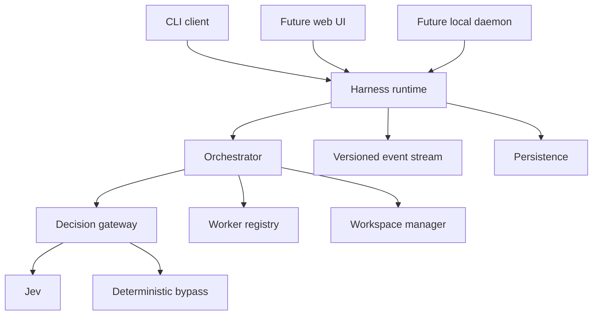
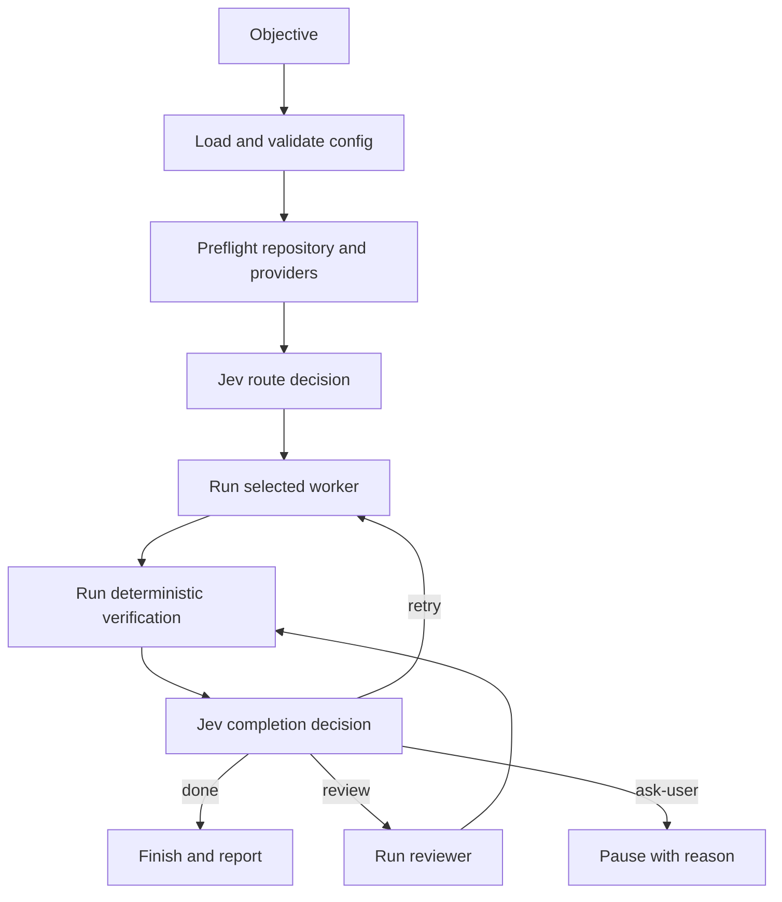

# Adaptive Agent Harness: Foundation Architecture and Milestone 1 Plan

Status: implementation-ready product foundation  
Runtime: Bun + TypeScript  
Configuration: YAML or TOML  
Permanent decision engine: TypeSafe Jev  
Initial workers: OpenAI Codex CLI and Cursor Agent CLI with Composer 2.5

> **Architecture amendment (September 2026).** The harness follows the Jev
> state/context model: canonical run state is stored as typed, addressable
> chunks and context is assembled per operation. The harness coordinates
> existing CLIs, MCP servers, installed skills, and agent providers; it does
> not recreate their domain integrations. The initial capability set should
> use existing tools such as `git`, `gh`, configured verification commands,
> Codex, and Cursor. Advanced dynamic tool disclosure and MCP/skill loading
> remain later capabilities behind the same contracts.

## 1. Product goal

Build a durable, local-first agent harness that accepts a coding objective, uses Jev as its permanent control-plane decision engine, delegates work to Codex or Cursor Composer, runs deterministic verification, and records the complete run as a replayable event stream.

The first user-facing product is a CLI. The CLI is not the harness itself. It is the first client of a reusable runtime that will later support a local daemon, a web interface, multiple repositories, concurrent bots, and remote workers without replacing the core architecture.

Milestone 1 must be useful for real coding work while also producing the evidence needed to tune routing and decision policy. Benchmarking Jev remains important, but Jev is not an optional experiment that will be discarded if an initial benchmark is imperfect. It is a permanent architectural component whose questions, thresholds, and responsibilities will be refined over time.

The long-term product experience is:

> Give the harness an objective, watch specialized agents collaborate, understand why the system made each decision, intervene when necessary, and retain a complete record of token use, context, changes, and verification.

## 2. Core design principles

1. **Bun owns the local runtime.** Use Bun for dependency management, TypeScript execution, tests, process spawning, HTTP requests, and SQLite.
2. **Configuration owns policy.** Provider selection, prompts, thresholds, limits, and verification commands live in YAML or TOML rather than application code.
3. **Jev is the permanent decision plane.** It selects among explicit choices and scores narrow properties. It does not generate plans or code. A clearly defined bypass mode exists for outages, debugging, comparison runs, and emergency operation.
4. **Workers think and edit.** Codex and Composer inspect the repository, implement changes, and return reports.
5. **Code enforces policy.** TypeScript interprets decisions, applies thresholds, controls retries, and stops runs.
6. **Deterministic evidence outranks model claims.** Exit codes, test results, lint results, repository status, and diffs are authoritative inputs to completion decisions.
7. **Every action is observable.** Store events, decisions, worker calls, usage, durations, verification results, and run outcomes.
8. **Integrations stay replaceable.** Codex, Cursor, persistence, and future Headroom support sit behind interfaces. Jev also sits behind a gateway, but it remains the default and intended decision implementation.
9. **Safe defaults.** Require a Git repository, default to a clean worktree, set hard step and retry limits, and never place secrets in config files.
10. **The runtime is the product.** CLI, daemon, and web UI are clients of the same application contracts.
11. **Events are a protocol, not only logs.** Versioned run events power persistence, terminal streaming, recovery, and the future UI.
12. **Build a vertical slice, not throwaway code.** Milestone 1 limits scope while preserving the production boundaries and contracts.
13. **Reuse capabilities.** The harness registers, configures, and governs existing tools rather than rebuilding service integrations. For example, GitHub work invokes `gh` under policy rather than a bespoke GitHub client.

## 3. Milestone 1 boundary

### Included

- `harness config validate`
- `harness run "<objective>"`
- `harness runs list`
- `harness runs show <run-id>`
- YAML and TOML config parsing with the same validated schema
- Jev REST adapter
- Codex CLI adapter
- Cursor Agent CLI adapter
- A simple state-machine orchestrator
- Built-in SQLite telemetry through `bun:sqlite`
- Configured verification commands
- Human-readable console output and a `--json` mode
- Unit tests for config, policy, decisions, adapters, and transitions
- Integration tests with fake provider executables
- Reusable `HarnessRuntime` application API
- Versioned command and event protocol
- Durable pause, resume, cancel, and approval states
- Decision gateway with Jev and deterministic bypass modes
- Typed state chunks, a state-store boundary, and a minimal context-assembler boundary
- Configurable references to existing CLI, MCP, skill, and provider capabilities
- Bun workspace structure that can add a daemon and web UI without moving core code

### Deferred

- Headroom integration
- Web UI implementation
- Long-lived daemon implementation
- Distributed workers
- Simultaneous editing by multiple workers
- Automatic branch merging
- Arbitrary workflow definitions
- Remote execution
- Provider billing reconciliation beyond reported usage
- Autonomous destructive operations

These items are deferred capabilities, not deferred architecture. Milestone 1 must define the boundaries they will use even when their implementations arrive later.

## 4. Permanent product architecture



For Milestone 1, the CLI instantiates `HarnessRuntime` in-process:

```text
CLI -> HarnessRuntime -> SQLite + local worker processes
```

Later, the CLI and web UI connect to a daemon exposing the same command and event contracts:

```text
CLI ----+
        +-> local daemon -> HarnessRuntime
Web UI -+
```

No orchestration policy, Jev logic, provider execution, or persistence logic belongs in CLI command handlers or UI components.

## 5. Runtime flow



Milestone 1 runs one editing worker at a time. That avoids merge coordination and gives clean benchmark data. Research or review can be added as distinct sequential steps, but two workers do not edit the same worktree concurrently.

## 6. Configuration strategy

### Discovery order

1. A path supplied with `--config`.
2. `harness.yaml`.
3. `harness.yml`.
4. `harness.toml`.

If more than one default config file exists, fail and ask for `--config`. Silent precedence would make runs hard to reproduce.

### Configuration rules

- YAML and TOML deserialize into the same object shape.
- Validate the parsed object with Zod.
- Reject unknown keys in version 1.
- Secrets are referenced by environment variable name, never stored directly.
- Paths are resolved relative to the config file.
- CLI flags may override run-specific values such as workspace, dry-run, and JSON output.
- Write the normalized configuration and a SHA-256 digest into the run record.
- Support only `${ENV_NAME}` interpolation and reject missing variables.

### Canonical YAML example

```yaml
version: 1

project:
  name: adaptive-harness
  workspace: .

storage:
  database: .harness/harness.sqlite

decision:
  mode: jev
  allowBypass: true
  bypassEnv: HARNESS_DECISION_MODE
  jev:
    model: jev-latest
    baseUrl: https://api.typesafe.ai/v1/systemone
    apiKeyEnv: TYPESAFE_API_KEY
    timeoutMs: 15000
    transientRetries: 2
  fallback:
    onUnavailable: deterministic
    onLowConfidence: ask-user

providers:
  codex:
    kind: codex-cli
    command: codex
    model: null
    sandbox: workspace-write
    extraArgs: []

  composer:
    kind: cursor-cli
    command: cursor-agent
    model: composer-2.5
    outputFormat: stream-json
    extraArgs: []

agents:
  implementer:
    provider: composer
    purpose: implementation
    instructions: |
      Implement only the requested change. Preserve existing conventions.
      Run focused checks when practical. Do not modify unrelated files.

  reasoner:
    provider: codex
    purpose: implementation
    instructions: |
      Handle tasks requiring deeper repository analysis or complex debugging.
      Implement only after understanding the relevant architecture.

  reviewer:
    provider: codex
    purpose: review
    readOnly: true
    instructions: |
      Review the objective, diff, and verification evidence independently.
      Identify correctness issues, regressions, missing tests, and scope creep.

routing:
  defaultAgent: implementer
  complexAgent: reasoner
  reviewerAgent: reviewer
  complexTaskScore: 3.5
  requireReviewRiskScore: 3.0
  autoProceedConfidence: 0.85
  verifyConfidence: 0.65
  askUserBelowConfidence: 0.50

limits:
  maxSteps: 8
  maxRetriesPerTask: 2
  maxWorkerCalls: 5
  maxInputTokens: 1000000
  maxOutputTokens: 200000
  maxElapsedMs: 3600000
  workerTimeoutMs: 1200000

git:
  requireRepository: true
  requireClean: true
  allowUntracked: false

verification:
  stopOnFailure: false
  commands:
    - name: typecheck
      command: bun
      args: [run, typecheck]
      timeoutMs: 120000
    - name: tests
      command: bun
      args: [test]
      timeoutMs: 300000

telemetry:
  console: pretty
  retainRawProviderEvents: true
  redactEnvironment:
    - TYPESAFE_API_KEY
```

### Equivalent TOML excerpt

```toml
version = 1

[project]
name = "adaptive-harness"
workspace = "."

[storage]
database = ".harness/harness.sqlite"

[decision]
mode = "jev"
allowBypass = true
bypassEnv = "HARNESS_DECISION_MODE"

[decision.jev]
model = "jev-latest"
baseUrl = "https://api.typesafe.ai/v1/systemone"
apiKeyEnv = "TYPESAFE_API_KEY"
timeoutMs = 15000
transientRetries = 2

[decision.fallback]
onUnavailable = "deterministic"
onLowConfidence = "ask-user"

[providers.codex]
kind = "codex-cli"
command = "codex"
sandbox = "workspace-write"
extraArgs = []

[providers.composer]
kind = "cursor-cli"
command = "cursor-agent"
model = "composer-2.5"
outputFormat = "stream-json"
extraArgs = []

[agents.implementer]
provider = "composer"
purpose = "implementation"
instructions = """
Implement only the requested change. Preserve existing conventions.
Run focused checks when practical. Do not modify unrelated files.
"""

[routing]
defaultAgent = "implementer"
complexAgent = "reasoner"
reviewerAgent = "reviewer"
complexTaskScore = 3.5
requireReviewRiskScore = 3.0
autoProceedConfidence = 0.85
verifyConfidence = 0.65
askUserBelowConfidence = 0.50

[limits]
maxSteps = 8
maxRetriesPerTask = 2
maxWorkerCalls = 5
maxInputTokens = 1000000
maxOutputTokens = 200000
maxElapsedMs = 3600000
workerTimeoutMs = 1200000

[[verification.commands]]
name = "tests"
command = "bun"
args = ["test"]
timeoutMs = 300000
```

## 7. Product repository layout

```text
adaptive-harness/
├── package.json
├── bun.lock
├── tsconfig.json
├── biome.json
├── harness.example.yaml
├── harness.example.toml
├── README.md
├── apps/
│   ├── cli/
│   │   ├── package.json
│   │   ├── src/cli.ts
│   │   └── test/
│   ├── daemon/                 # contract placeholder in M1, implementation in M3
│   └── web/                    # added after the daemon protocol is stable
├── packages/
│   ├── core/
│   │   ├── src/types.ts
│   │   ├── src/state-machine.ts
│   │   ├── src/policy.ts
│   │   └── test/
│   ├── protocol/
│   │   ├── src/commands.ts
│   │   ├── src/events.ts
│   │   ├── src/runtime.ts
│   │   └── test/
│   ├── config/
│   │   ├── src/loader.ts
│   │   ├── src/schema.ts
│   │   ├── src/interpolation.ts
│   │   └── test/
│   ├── runtime/
│   │   ├── src/orchestrator.ts
│   │   ├── src/run-controller.ts
│   │   ├── src/prompts.ts
│   │   ├── src/recovery.ts
│   │   └── test/
│   ├── decisions/
│   │   ├── src/gateway.ts
│   │   ├── src/jev-client.ts
│   │   ├── src/deterministic.ts
│   │   ├── src/questions.ts
│   │   └── test/
│   ├── workers/
│   │   ├── src/registry.ts
│   │   ├── src/codex-cli.ts
│   │   ├── src/cursor-cli.ts
│   │   ├── src/jsonl.ts
│   │   └── test/
│   ├── workspace/
│   │   ├── src/git.ts
│   │   ├── src/manager.ts
│   │   └── test/
│   ├── verification/
│   │   ├── src/runner.ts
│   │   └── test/
│   ├── persistence/
│   │   ├── src/contracts.ts
│   │   ├── src/sqlite.ts
│   │   ├── src/migrations.ts
│   │   └── test/
│   └── telemetry/
│       ├── src/reporter.ts
│       ├── src/redaction.ts
│       └── test/
└── test/
    ├── fixtures/
    ├── fakes/
    ├── integration/
    └── live/
```

The workspace boundaries are part of the product design. Composer should not collapse these packages into one `src` directory for convenience.

## 8. Root `package.json`

The package is private during Milestone 1. Bun supplies `fetch`, `Bun.spawn`, `bun:test`, UUID generation, and SQLite, so the dependency list stays deliberately small.

```json
{
  "name": "@adaptive-harness/root",
  "version": "0.1.0",
  "private": true,
  "type": "module",
  "description": "A Jev-directed agent harness for Codex, Cursor, and future worker providers",
  "workspaces": ["apps/*", "packages/*"],
  "scripts": {
    "dev": "bun --filter @adaptive-harness/cli dev",
    "build": "bun run --filter '*' build",
    "compile": "bun --filter @adaptive-harness/cli compile",
    "typecheck": "bun run --filter '*' typecheck",
    "test": "bun test",
    "test:watch": "bun test --watch",
    "check": "bunx biome check .",
    "check:fix": "bunx biome check --write .",
    "validate": "bun run typecheck && bun run check && bun test && bun run build"
  },
  "engines": {
    "bun": ">=1.2.0"
  },
  "devDependencies": {
    "@biomejs/biome": "^2.2.4",
    "@types/bun": "^1.2.22",
    "typescript": "^5.9.2"
  }
}
```

Each workspace owns its runtime dependencies. The CLI package owns Commander. The config package owns Zod, YAML, and TOML parsing. Packages depend on one another through workspace references such as `"@adaptive-harness/core": "workspace:*"`.

Before the initial commit, install with `bun install`, run `bun update`, inspect the resolved versions, and commit `bun.lock`. The lockfile, not the ranges above, becomes the reproducibility boundary.

## 9. Core TypeScript types

Create `packages/core/src/types.ts` with the domain contracts below. Configuration schemas belong in `packages/config/src/schema.ts`; this file contains runtime concepts and adapter boundaries.

```ts
export type RunId = string;
export type TaskId = string;
export type WorkerCallId = string;
export type DecisionId = string;

export type TaskKind = "implementation" | "debugging" | "architecture" | "research" | "review";

export type RunStatus =
  "created" | "routing" | "running" | "verifying" | "reviewing" | "paused" | "completed" | "failed" | "cancelled";

export type NextAction = "done" | "retry" | "verify" | "review" | "research" | "ask-user" | "fail";

export type AgentPurpose = "implementation" | "research" | "review";

export interface Objective {
  text: string;
  acceptanceCriteria: string[];
  suppliedContext?: string;
}

export interface HarnessTask {
  id: TaskId;
  runId: RunId;
  parentTaskId?: TaskId;
  kind: TaskKind;
  objective: Objective;
  attempt: number;
  assignedAgent?: string;
  status: "pending" | "running" | "completed" | "failed" | "paused";
  createdAt: string;
  updatedAt: string;
}

export interface Usage {
  inputTokens?: number;
  cachedInputTokens?: number;
  outputTokens?: number;
}

export interface FileChange {
  path: string;
  status: "added" | "modified" | "deleted" | "renamed" | "unknown";
  additions?: number;
  deletions?: number;
}

export interface WorkerRequest {
  runId: RunId;
  task: HarnessTask;
  agentName: string;
  instructions: string;
  workspace: string;
  model?: string;
  readOnly: boolean;
  timeoutMs: number;
  environment: Record<string, string>;
}

export interface WorkerReport {
  summary: string;
  completed: boolean;
  filesChanged: FileChange[];
  checksRun: string[];
  concerns: string[];
  requestedHelp?: string;
}

export interface WorkerResult {
  id: WorkerCallId;
  provider: string;
  status: "succeeded" | "failed" | "timed-out" | "cancelled";
  startedAt: string;
  finishedAt: string;
  durationMs: number;
  exitCode: number | null;
  sessionId?: string;
  report?: WorkerReport;
  finalOutput: string;
  usage: Usage;
  rawEventCount: number;
  error?: string;
}

export interface WorkerAdapter {
  readonly kind: "codex-cli" | "cursor-cli";

  preflight(): Promise<ProviderPreflight>;

  execute(request: WorkerRequest, emit: (event: WorkerStreamEvent) => void | Promise<void>): Promise<WorkerResult>;

  cancel(callId: WorkerCallId): Promise<void>;
}

export interface ProviderPreflight {
  ok: boolean;
  version?: string;
  authenticated?: boolean;
  details: string[];
}

export type WorkerStreamEvent =
  | { type: "session.started"; sessionId?: string; at: string }
  | { type: "message"; role: "assistant" | "system"; text: string; at: string }
  | { type: "tool.started"; name: string; callId?: string; at: string }
  | { type: "tool.completed"; name: string; callId?: string; ok: boolean; at: string }
  | { type: "usage"; usage: Usage; at: string }
  | { type: "provider.raw"; value: unknown; at: string };

export type DecisionQuestion =
  | {
      type: "choice";
      instructions: string;
      criteria: Record<string, string>;
    }
  | {
      type: "score";
      instructions: string;
      criteria: string[];
    }
  | {
      type: "noul";
      instructions: string;
    };

export type DecisionAnswer =
  | {
      type: "choice";
      choice: string;
      confidence: number;
      probabilities: Record<string, number>;
    }
  | {
      type: "score";
      score: number;
      confidence: number;
      probabilities: Record<string, number>;
      legend?: Record<string, string>;
    }
  | {
      type: "noul";
      noul: number;
    };

export interface DecisionRequest {
  state: string;
  questions: Record<string, DecisionQuestion>;
}

export interface DecisionResponse {
  id: DecisionId;
  model: string;
  answers: Record<string, DecisionAnswer>;
  usage: Usage;
  durationMs: number;
  raw: unknown;
}

export interface DecisionProvider {
  readonly kind: "jev" | "deterministic";
  preflight(): Promise<ProviderPreflight>;
  evaluate(request: DecisionRequest): Promise<DecisionResponse>;
}

export interface RouteDecision {
  taskKind: TaskKind;
  taskKindConfidence: number;
  complexityScore: number;
  complexityConfidence: number;
  needsExternalResearch: number;
  requirementsClear: number;
  selectedAgent: string;
  reasonCodes: string[];
}

export interface CompletionDecision {
  requirementsSatisfied: number;
  implementationRiskScore: number;
  implementationRiskConfidence: number;
  moreWorkUseful: number;
  needsIndependentReview: number;
  nextAction: NextAction;
  nextActionConfidence: number;
  reasonCodes: string[];
}

export interface VerificationCommandResult {
  name: string;
  command: string;
  args: string[];
  exitCode: number | null;
  timedOut: boolean;
  durationMs: number;
  stdout: string;
  stderr: string;
}

export interface VerificationResult {
  ok: boolean;
  commands: VerificationCommandResult[];
  gitDiffStat: string;
  filesChanged: FileChange[];
}

export interface RunBudget {
  workerCalls: number;
  inputTokens: number;
  /** Cached subset of `inputTokens`; optional so stored runs stay readable. */
  cachedInputTokens?: number;
  outputTokens: number;
  elapsedMs: number;
}

export interface HarnessRun {
  id: RunId;
  status: RunStatus;
  objective: Objective;
  workspace: string;
  configPath: string;
  configHash: string;
  currentTaskId?: TaskId;
  currentStep: number;
  budget: RunBudget;
  createdAt: string;
  updatedAt: string;
  completedAt?: string;
  failureReason?: string;
}

export type HarnessEvent =
  | { type: "run.created"; run: HarnessRun }
  | { type: "run.status-changed"; runId: RunId; from: RunStatus; to: RunStatus }
  | { type: "decision.requested"; runId: RunId; phase: "route" | "completion" | "handoff" | "context" }
  | { type: "decision.completed"; runId: RunId; decision: DecisionResponse }
  | { type: "decision.bypassed"; runId: RunId; reason: string }
  | { type: "worker.started"; runId: RunId; taskId: TaskId; callId: WorkerCallId }
  | { type: "worker.event"; runId: RunId; callId: WorkerCallId; event: WorkerStreamEvent }
  | { type: "worker.completed"; runId: RunId; taskId: TaskId; result: WorkerResult }
  | { type: "verification.completed"; runId: RunId; result: VerificationResult }
  | { type: "policy.action"; runId: RunId; action: NextAction; reasonCodes: string[] }
  | { type: "approval.requested"; request: ApprovalRequest }
  | { type: "approval.answered"; request: ApprovalRequest }
  | { type: "run.paused"; runId: RunId; reason: string }
  | { type: "run.resumed"; runId: RunId }
  | { type: "run.cancelled"; runId: RunId; reason?: string }
  | { type: "run.planned"; runId: RunId; plan: RunPlan }
  | { type: "run.completed"; run: HarnessRun }
  | { type: "run.failed"; run: HarnessRun; error: string };

export interface EventSink {
  append(event: EventEnvelope): Promise<void>;
}

export interface EventEnvelope<T extends HarnessEvent = HarnessEvent> {
  id: string;
  version: 1;
  sequence: number;
  runId: RunId;
  occurredAt: string;
  correlationId: string;
  causationId?: string;
  payload: T;
}

export interface CreateRunInput {
  objective: Objective;
  workspace: string;
  configPath: string;
  idempotencyKey?: string;
}

export interface ApprovalRequest {
  id: string;
  runId: RunId;
  taskId?: TaskId;
  kind: "clarification" | "permission" | "risk-acceptance";
  prompt: string;
  choices?: string[];
  status: "pending" | "answered" | "cancelled";
  answer?: string;
  createdAt: string;
  answeredAt?: string;
}

export interface HarnessRuntime {
  createRun(input: CreateRunInput): Promise<HarnessRun>;
  startRun(runId: RunId): Promise<void>;
  pauseRun(runId: RunId): Promise<void>;
  resumeRun(runId: RunId): Promise<void>;
  cancelRun(runId: RunId): Promise<void>;
  answerApproval(requestId: string, answer: string): Promise<void>;
  getRun(runId: RunId): Promise<HarnessRun>;
  listRuns(options?: { limit?: number; status?: RunStatus }): Promise<HarnessRun[]>;
  subscribe(runId: RunId, afterSequence?: number): AsyncIterable<EventEnvelope>;
}
```

`HarnessRuntime` is the primary application boundary. CLI commands call this interface. The future daemon implements the same interface over HTTP and streams the same event envelopes to CLI and web clients.

## 10. Configuration schema types

Use discriminated Zod schemas so provider-specific fields remain strongly typed.

```ts
import { z } from "zod";

const CodexProviderSchema = z
  .object({
    kind: z.literal("codex-cli"),
    command: z.string().min(1).default("codex"),
    model: z.string().min(1).nullable().optional(),
    sandbox: z.enum(["read-only", "workspace-write", "danger-full-access"]).default("workspace-write"),
    extraArgs: z.array(z.string()).default([]),
  })
  .strict();

const CursorProviderSchema = z
  .object({
    kind: z.literal("cursor-cli"),
    command: z.string().min(1).default("cursor-agent"),
    model: z.string().min(1).nullable().optional(),
    outputFormat: z.enum(["json", "stream-json", "text"]).default("stream-json"),
    extraArgs: z.array(z.string()).default([]),
  })
  .strict();

const ProviderSchema = z.discriminatedUnion("kind", [CodexProviderSchema, CursorProviderSchema]);

const VerificationCommandSchema = z
  .object({
    name: z.string().min(1),
    command: z.string().min(1),
    args: z.array(z.string()).default([]),
    timeoutMs: z.number().int().positive().default(300_000),
    env: z.record(z.string(), z.string()).default({}),
  })
  .strict();

export const HarnessConfigSchema = z
  .object({
    version: z.literal(1),
    project: z
      .object({
        name: z.string().min(1),
        workspace: z.string().min(1).default("."),
      })
      .strict(),
    storage: z.object({ database: z.string().min(1).default(".harness/harness.sqlite") }).strict(),
    decision: z
      .object({
        mode: z.enum(["jev", "deterministic"]).default("jev"),
        allowBypass: z.boolean().default(true),
        bypassEnv: z.string().min(1).default("HARNESS_DECISION_MODE"),
        jev: z
          .object({
            model: z.string().min(1).default("jev-latest"),
            baseUrl: z.url().default("https://api.typesafe.ai/v1/systemone"),
            apiKeyEnv: z.string().min(1).default("TYPESAFE_API_KEY"),
            timeoutMs: z.number().int().positive().default(15_000),
            transientRetries: z.number().int().min(0).max(5).default(2),
          })
          .strict(),
        fallback: z
          .object({
            onUnavailable: z.enum(["deterministic", "ask-user", "fail"]),
            onLowConfidence: z.enum(["deterministic", "ask-user", "fail"]),
          })
          .strict(),
      })
      .strict(),
    providers: z.record(z.string(), ProviderSchema),
    agents: z.record(
      z.string(),
      z
        .object({
          provider: z.string().min(1),
          purpose: z.enum(["implementation", "research", "review"]),
          instructions: z.string().min(1),
          readOnly: z.boolean().default(false),
        })
        .strict(),
    ),
    routing: z
      .object({
        defaultAgent: z.string().min(1),
        complexAgent: z.string().min(1),
        reviewerAgent: z.string().min(1),
        complexTaskScore: z.number().min(0).max(4).default(3),
        requireReviewRiskScore: z.number().min(0).max(4).default(3),
        autoProceedConfidence: z.number().min(0).max(1).default(0.85),
        verifyConfidence: z.number().min(0).max(1).default(0.65),
        askUserBelowConfidence: z.number().min(0).max(1).default(0.5),
      })
      .strict(),
    limits: z
      .object({
        maxSteps: z.number().int().positive().default(8),
        maxRetriesPerTask: z.number().int().nonnegative().default(2),
        maxWorkerCalls: z.number().int().positive().default(5),
        /** Counts uncached input tokens; cached input is excluded. */
        maxInputTokens: z.number().int().positive().default(1_000_000),
        /** Counts output tokens reported by workers. */
        maxOutputTokens: z.number().int().positive().default(200_000),
        maxElapsedMs: z.number().int().positive().default(3_600_000),
        workerTimeoutMs: z.number().int().positive().default(1_200_000),
      })
      .strict(),
    git: z
      .object({
        requireRepository: z.boolean().default(true),
        requireClean: z.boolean().default(true),
        allowUntracked: z.boolean().default(false),
      })
      .strict(),
    verification: z
      .object({
        stopOnFailure: z.boolean().default(false),
        commands: z.array(VerificationCommandSchema).default([]),
      })
      .strict(),
    telemetry: z
      .object({
        console: z.enum(["pretty", "json", "silent"]).default("pretty"),
        retainRawProviderEvents: z.boolean().default(true),
        redactEnvironment: z.array(z.string()).default([]),
      })
      .strict(),
  })
  .strict()
  .superRefine((config, context) => {
    for (const [agentName, agent] of Object.entries(config.agents)) {
      if (!config.providers[agent.provider]) {
        context.addIssue({
          code: "custom",
          path: ["agents", agentName, "provider"],
          message: `Unknown provider: ${agent.provider}`,
        });
      }
    }

    for (const name of [config.routing.defaultAgent, config.routing.complexAgent, config.routing.reviewerAgent]) {
      if (!config.agents[name]) {
        context.addIssue({
          code: "custom",
          path: ["routing"],
          message: `Unknown routed agent: ${name}`,
        });
      }
    }
  });

export type HarnessConfig = z.infer<typeof HarnessConfigSchema>;
export type ProviderConfig = z.infer<typeof ProviderSchema>;
```

The score criteria in this design use five entries indexed `0` through `4`, so routing thresholds must also remain in the `0..4` range.

## 11. Jev decision plane and gateway

Jev is a permanent part of the harness. The gateway exists to centralize resilience and policy, not to make Jev disposable.

Normal production flow:

```text
Orchestrator -> DecisionGateway -> Jev -> typed decision -> policy
```

Bypass flow for outages, debugging, and controlled comparisons:

```text
Orchestrator -> DecisionGateway -> deterministic rules -> policy
```

The default is always Jev. Bypass must be explicit through one of these mechanisms:

```bash
harness run "<objective>" --decision-mode deterministic
HARNESS_DECISION_MODE=deterministic harness run "<objective>"
```

The CLI override is allowed only when `decision.allowBypass` is true. Every bypass must emit a `decision.bypassed` event with a reason. Silent fallback is prohibited.

```ts
export type DecisionMode = "jev" | "deterministic";

export interface DecisionContext {
  runId: RunId;
  phase: "route" | "completion" | "handoff" | "context" | "tool" | "permission" | "delegation";
  mode: DecisionMode;
  reason?: string;
}

export interface DecisionGateway {
  evaluate(context: DecisionContext, request: DecisionRequest): Promise<DecisionResponse>;
}
```

The deterministic implementation is deliberately conservative. It may route known simple tasks, stop on failed verification, request review for configured high-risk file patterns, and ask the user when uncertain. It must not attempt to imitate Jev with a growing pile of hidden heuristics.

### Jev question design

Jev receives one state string and several atomic questions. Questions are evaluated independently, so do not make one question depend on another answer.

### Initial routing questions

```ts
export const routeQuestions = {
  task_kind: {
    type: "choice",
    instructions: "Classify the primary kind of work required by the objective",
    criteria: {
      implementation: "A bounded code change with sufficiently clear requirements",
      debugging: "The cause of incorrect behavior must be identified and fixed",
      architecture: "The task requires consequential system design before implementation",
      research: "The task primarily requires gathering information",
      review: "The task primarily requires evaluating an existing change",
    },
  },
  complexity: {
    type: "score",
    instructions: "Score the engineering complexity of completing this objective",
    criteria: [
      "Trivial and localized",
      "Small and well understood",
      "Moderate with several interacting concerns",
      "Complex and cross-cutting",
      "Highly complex or architecturally consequential",
    ],
  },
  requirements_clear: {
    type: "noul",
    instructions: "The objective is clear enough for an agent to begin safely",
  },
  external_research_needed: {
    type: "noul",
    instructions: "Completing the objective requires information not likely present in the repository",
  },
} as const;
```

Code chooses the agent from `task_kind`, `complexity`, confidence, and config policy. Do not ask Jev to return an arbitrary provider name. That would couple the decision model to deploy-time configuration.

### Completion questions

```ts
export const completionQuestions = {
  requirements_satisfied: {
    type: "noul",
    instructions: "The current repository changes satisfy the stated objective and acceptance criteria",
  },
  implementation_risk: {
    type: "score",
    instructions: "Score the risk of merging the current changes",
    criteria: ["Trivial risk", "Low risk", "Moderate risk", "High risk", "Critical risk"],
  },
  more_work_useful: {
    type: "noul",
    instructions: "Another implementation attempt is likely to materially improve the result",
  },
  independent_review_needed: {
    type: "noul",
    instructions: "The current change warrants an independent agent review before completion",
  },
  next_action: {
    type: "choice",
    instructions: "Choose the most appropriate immediate next action",
    criteria: {
      done: "The objective is satisfied and evidence is adequate",
      retry: "Implementation needs another attempt",
      verify: "More deterministic verification is needed",
      review: "An independent review is needed",
      research: "Missing information blocks reliable completion",
      ask_user: "A human decision or clarification is required",
      fail: "The run cannot make useful progress within its constraints",
    },
  },
} as const;
```

### State and context construction

`StateChunk`s are the canonical, addressable record of a run. A transcript,
raw provider event, file read, diff, or instruction can produce a chunk, but
none is itself the complete state. Before each operation, `ContextAssembler`
selects bounded factual chunks and records the selection. Milestone 1 begins
with deterministic selection; Jev visibility scoring is an additive policy
behind that seam.

Jev receives the compact rendering of a `ContextAssembly`, not an accumulated
conversation. A first rendering is:

```text
OBJECTIVE
<objective and acceptance criteria>

WORKER RESULT
<structured worker report>

REPOSITORY EVIDENCE
<git status, diff stat, bounded diff summary>

VERIFICATION
<command names, exit codes, durations, bounded stderr/stdout tails>

RUN LIMITS
<attempts, remaining worker calls, remaining token budget>
```

The assembly also retains the ordered chunk IDs, visibility level, and rendered
content hash as evidence. This makes a later context choice replayable without
turning transcripts into the source of truth.

Never send unrestricted build logs or a full repository diff to Jev. Cap each evidence section and persist the full data separately.

## 12. Worker adapter behavior

### Codex

Use a non-interactive execution similar to:

```text
codex exec \
  --json \
  --sandbox workspace-write \
  --cd <workspace> \
  --output-schema <temporary-worker-report-schema.json> \
  -
```

Pipe the composed prompt through stdin. Add `--model` only when the config explicitly sets a model. Parse JSONL defensively and preserve unknown event fields as raw events.

For the read-only reviewer, use `--sandbox read-only` and instruct it to return findings without modifying files.

### Cursor Composer

Use a non-interactive execution similar to:

```text
cursor-agent \
  --print \
  --output-format stream-json \
  --workspace <workspace> \
  --model composer-2.5 \
  "<prompt>"
```

Cursor's stream JSON format should be parsed one line at a time. Consumers must ignore unknown fields because the format permits backward-compatible additions.

Cursor non-interactive mode has write access. The harness must enforce clean-worktree checks, limits, and post-run diff inspection rather than assuming the worker CLI will provide the same sandbox boundary as Codex.

For both providers:

- Use `Bun.spawn` with an argument array. Never construct a shell command string.
- Pipe stdout and stderr separately.
- Abort with `AbortController` and kill the process tree on timeout.
- Capture provider version during preflight.
- Redact configured environment variables from persisted events.
- Treat the worker's self-reported completion as evidence, not truth.
- Compute changed files from Git after the process exits.

## 13. Policy logic

Keep policy deterministic and unit-testable.

```ts
export function selectInitialAgent(route: RouteDecision, config: HarnessConfig): string | NextAction {
  if (route.requirementsClear < config.routing.askUserBelowConfidence) {
    return "ask-user";
  }

  if (route.taskKind === "architecture" || route.complexityScore >= config.routing.complexTaskScore) {
    return config.routing.complexAgent;
  }

  return config.routing.defaultAgent;
}

export function selectNextAction(
  decision: CompletionDecision,
  verification: VerificationResult,
  run: HarnessRun,
  config: HarnessConfig,
  progress: {
    reviewCompletedForAttempt: boolean;
    editsSinceReview: boolean;
    failedCall?: "implementation" | "review";
    retryAvailable?: boolean;
  },
): NextAction {
  const action = selectUnboundedAction(decision, verification, config, progress);
  if (action === "done" && progress.failedCall) {
    const canRetry =
      progress.failedCall === "implementation" &&
      progress.retryAvailable !== false &&
      !exhaustedBudget(run, config.limits);
    return canRetry ? "retry" : "ask-user";
  }
  // Budgets stop further work; they do not discard a satisfied result or a request for human judgment.
  if (action === "done" || action === "ask-user") return action;
  return exhaustedBudget(run, config.limits) ? "fail" : action;
}

function selectUnboundedAction(decision, verification, config, progress): NextAction {
  if (!verification.ok && decision.moreWorkUseful >= 0.65) return "retry";

  const reviewRequested =
    decision.implementationRiskScore >= config.routing.requireReviewRiskScore ||
    decision.needsIndependentReview >= config.routing.autoProceedConfidence ||
    decision.nextAction === "review";
  const reviewEligible = !progress.reviewCompletedForAttempt || progress.editsSinceReview;
  if (reviewRequested) return reviewEligible ? "review" : "ask-user";

  if (decision.nextActionConfidence < config.routing.askUserBelowConfidence) return "ask-user";

  if (
    decision.requirementsSatisfied >= config.routing.autoProceedConfidence &&
    verification.ok &&
    decision.moreWorkUseful < 0.35
  ) {
    return "done";
  }

  if (!verification.ok && decision.nextAction === "done") return "ask-user";

  return decision.nextAction;
}
```

When verification failed, the policy never completes the run: a provider `done` becomes `ask-user` so a person can accept the result or send it back. Passing verification leaves provider `done` unchanged.

A failed worker call never completes the run either. When the latest call failed, was cancelled, or was interrupted, a `done` becomes `retry` for an implementation call while the retry limit and budgets allow another attempt, and `ask-user` otherwise or for a review call. The runtime records `worker-failed` in the reason codes of any action that follows a failed call. A failed review does not count as the attempt's completed review.

`exhaustedBudget` checks steps, worker calls, uncached input tokens (`inputTokens` minus `cachedInputTokens`, never below zero; cached input does not count toward `maxInputTokens`), output tokens (`maxOutputTokens`), and active elapsed time. The runtime applies further guards when it acts on the selected action: a retry beyond `maxRetriesPerTask` fails with `retry-limit`, `verify` and `research` (not yet supported as runtime actions) become `ask-user`, and streamed worker usage beyond the input or output token budget cancels the call in flight.

Budgets are token-based because the worker CLIs run on subscriptions and report tokens, never cost; the harness records and limits no dollar figure. A config that still sets `limits.maxCostUsd` loads with a warning and the value is ignored.

A review happens at most once per implementation attempt unless new edits are made; a repeated review request asks the person instead.

## 14. SQLite telemetry

Use `bun:sqlite` and enable WAL mode. Start with these tables:

| Table                | Purpose                                                          |
| -------------------- | ---------------------------------------------------------------- |
| `runs`               | Objective, status, config hash, workspace, timestamps, outcome   |
| `tasks`              | Task tree, attempts, assignments, and status                     |
| `events`             | Ordered append-only run timeline                                 |
| `state_chunks`       | Typed, addressable evidence from users, tools, files, and agents |
| `context_assemblies` | Selected chunk IDs, visibility, rendered hash, and purpose       |
| `decisions`          | Jev request state hash, questions, answers, usage, and latency   |
| `worker_calls`       | Provider, model, session, status, duration, usage, and result    |
| `worker_events`      | Parsed or raw provider stream events                             |
| `verification_runs`  | Command, arguments, exit code, bounded output, and duration      |
| `file_changes`       | Changed paths and diff statistics per step                       |

Store large raw payloads as JSON text initially. For the local-first implementation, operational simplicity matters more than fully normalized analytics.

Important indexes:

- `events(run_id, sequence)`
- `tasks(run_id, created_at)`
- `decisions(run_id, created_at)`
- `worker_calls(run_id, created_at)`

## 15. CLI contract

```text
harness config validate [--config path]
harness run <objective> [--config path] [--workspace path] [--decision-mode jev|deterministic] [--dry-run] [--json]
harness runs list [--limit number] [--json]
harness runs show <run-id> [--events] [--json]
harness runs watch <run-id> [--after sequence]
harness pause <run-id>
harness resume <run-id>
harness cancel <run-id>
harness approvals answer <request-id> <answer>
harness agents list [--json]
harness providers doctor [--json]
```

Example:

```bash
export TYPESAFE_API_KEY="..."
bun run src/cli.ts config validate --config harness.yaml
bun run src/cli.ts run "Add cursor pagination to the users endpoint" \
  --config harness.yaml \
  --workspace ../target-repository
```

`--dry-run` performs config validation, provider preflight, Git checks, and the Jev route decision, but does not invoke a writing worker. A dry run is persisted like any other run with `dryRun: true`: it stops after the route decision, records the plan (route, selected agent, access mode, and that agent's provider preflight) as a `run.planned` event and a `plan` state chunk, and ends as `completed`. When routing would need a person, the plan records a typed `unresolved` reason instead of requesting an approval. Errors that would fail a live run, such as a route to an unknown agent, fail the dry run too. `--decision-mode deterministic` is an explicit emergency or comparison override and must be recorded in the event stream.

## 16. Implementation milestones

### Milestone 1.0: Workspace bootstrap

1. Create the Bun workspace and package boundaries shown above.
2. Add root and workspace package manifests, TypeScript config, Biome config, and `.gitignore`.
3. Add YAML and TOML example configs.
4. Establish `bun run validate` as the local quality gate.

Exit criteria:

- `bun install` succeeds.
- `bun run typecheck`, `bun test`, `bun run check`, and `bun run build` succeed.

### Milestone 1.1: Protocol, configuration, and CLI shell

1. Define `StateChunk`, `StateStore`, `ContextAssembler`, task access, and external-capability contracts before implementing config parsing.
2. Implement discovery and explicit `--config` handling.
3. Parse YAML with `yaml` and TOML with `smol-toml`.
4. Interpolate approved environment syntax.
5. Validate with strict Zod schemas.
6. Resolve paths relative to the config file.
7. Add `config validate` and useful path-specific error messages.

Exit criteria:

- Equivalent YAML and TOML fixtures normalize to the same object.
- Unknown keys, missing secrets, invalid references, and multiple default files fail clearly.

### Milestone 1.2: Persistence and versioned event protocol

1. Create SQLite migrations with `bun:sqlite`.
2. Persist typed state chunks separately from events and support bounded run-scoped lookup.
3. Implement a minimal deterministic `ContextAssembler` that records the selected chunks and visibility.
4. Implement the append-only event sink.
5. Add run, task, decision, and worker-call repositories.
6. Add `runs list` and `runs show`.

Exit criteria:

- A synthetic run can be created, updated, queried, and rendered.
- Event order remains stable across process restarts.

### Milestone 1.3: Permanent Jev decision plane

1. Implement the `DecisionGateway` and `POST /v1/systemone` with Bun's `fetch`.
2. Add timeout, retry only for safe transient failures, and response validation.
3. Build initial route and completion question sets.
4. Normalize Jev responses into domain decisions.
5. Implement the conservative deterministic bypass and explicit bypass events.
6. Record exact model, usage, latency, raw response, selected mode, and fallback reason.

Exit criteria:

- Contract tests pass against recorded fixtures.
- A live smoke test is opt-in and requires `TYPESAFE_API_KEY`.

### Milestone 1.4: Worker adapters

1. Build a reusable Bun process runner.
2. Implement JSONL parsing with bounded buffers.
3. Implement Codex preflight and execution.
4. Implement Cursor preflight and execution.
5. Normalize provider events and final results.
6. Add fake executable fixtures to test timeouts, invalid JSON, nonzero exits, and cancellation.

Exit criteria:

- Both adapters run a read-only task against a fixture repository.
- Timeouts and process failures become typed results rather than unhandled errors.

### Milestone 1.5: Workspace management, verification, and Git evidence

1. Implement repository preflight.
2. Enforce clean-worktree policy.
3. Capture before and after Git state.
4. Execute configured verification commands without a shell.
5. Bound output stored in decision state while retaining full output in telemetry when configured.

Exit criteria:

- Verification accurately reports mixed passing and failing commands.
- Existing user changes cannot be silently attributed to the worker.

### Milestone 1.6: Recoverable runtime and orchestrator

1. Implement explicit state transitions.
2. Route the initial objective.
3. Select and execute one worker.
4. Verify the repository.
5. Request completion decisions.
6. Apply deterministic policy and budgets.
7. Support done, retry, review, ask-user, and fail outcomes.
8. Implement pause, resume, cancel, approval response, and startup recovery.
9. Expose all operations through `HarnessRuntime` rather than CLI-specific functions.

`LocalHarnessRuntime` (`packages/runtime/src/runtime.ts`) implements this milestone. A run is driven only by the runtime holding its lease, and each step commits the run, its checkpoint, and its events atomically. A worker call is persisted as in flight before it starts. After a restart, `recoverInterruptedRuns` pauses active runs whose lease is stale, and resuming reuses the saved result of an in-flight call or records it as interrupted. The call is never started again. The runtime captures a Git fingerprint baseline before each worker call and treats `changesSinceBaseline` as the authoritative set of worker changes. A read-only worker that changes anything fails the run, including a further edit to a file that was already dirty. Adapter `filesChanged` (status-line attribution) remains a provider-level hint only. Pausing cancels an in-flight call and keeps its result; paused time is not charged to the time budget.

Exit criteria:

- End-to-end tests cover every terminal state.
- Step, retry, worker-call, token, and time limits always stop the run.

### Milestone 1.7: Benchmark and evaluation suite

1. Define 10 to 20 small coding tasks across fixture repositories.
2. Run each task in baseline and Jev-routed modes.
3. Record tests passed, human intervention, calls, tokens, and time.
4. Review incorrect routing and threshold behavior manually.

Exit criteria:

- Results can answer whether routing reduced expensive calls without lowering correctness.
- Threshold changes are config-only and do not require code edits.

## 17. Testing strategy

### Unit tests

- YAML/TOML equivalence
- Config reference validation
- Environment interpolation and secret redaction
- Jev response normalization
- Policy thresholds and budget guards
- State-machine transition legality
- JSONL parsing and unknown-event tolerance
- Prompt construction and evidence size caps

### Integration tests

- Fake Jev HTTP server
- Fake `codex` and `cursor-agent` executables placed first on `PATH`
- Temporary Git repositories
- Passing and failing verification commands
- Process timeout and cancellation
- SQLite restart and event replay

### Live smoke tests

Keep live tests behind explicit environment flags:

```bash
RUN_LIVE_JEV=1 bun test test/live/jev.test.ts
RUN_LIVE_CODEX=1 bun test test/live/codex.test.ts
RUN_LIVE_CURSOR=1 bun test test/live/cursor.test.ts
```

Do not run paid or account-backed tests in the default suite.

## 18. Safety requirements

- Never pass the objective through a shell.
- Never support `danger-full-access` without an explicit config value and a prominent warning.
- Never persist API key values.
- Require user confirmation before any future destructive workflow such as deleting branches or resetting files.
- Default to a clean Git worktree during Milestone 1.
- Stop if the repository changes outside the active worker process.
- Cap all retained stdout, stderr, raw provider events, and Jev state sections.
- Store hashes for large omitted values so evidence can be correlated later.
- Treat provider output as untrusted input and validate all structured data.

## 19. Benchmark metrics

Track these per run:

- Objective completed
- Verification passed
- Human intervention required
- Wrong initial route
- Worker calls by provider
- Jev calls
- Input, cached input, and output tokens when available
- Wall-clock duration
- Number of retries
- Number of review cycles
- Files changed
- Scope-creep findings
- Final diff accepted or rejected

Do not claim savings from raw token reduction alone. A cheaper run that fails more often or creates worse diffs is not an improvement.

## 20. First build sequence

Use this order for the actual implementation:

```bash
mkdir adaptive-agent-harness
cd adaptive-agent-harness
bun init -y
mkdir -p apps/cli/src
mkdir -p packages/{core,protocol,config,runtime,decisions,workers,workspace,verification,persistence,telemetry}/src
bun add -d @biomejs/biome @types/bun typescript
```

Then:

1. Replace the generated root `package.json` with the workspace manifest in this document.
2. Add a shared strict `tsconfig.json` and one package manifest per workspace.
3. Implement `core` and `protocol` first, with no dependency on CLI, SQLite, or provider packages.
4. Implement the config schema and loader in `packages/config`.
5. Implement persistence contracts and the SQLite adapter.
6. Implement the decision gateway, Jev client, and deterministic bypass.
7. Implement the shared process runner and worker registry.
8. Implement Codex and Cursor adapters.
9. Implement workspace management, verification, and Git evidence.
10. Implement `HarnessRuntime`, recovery, orchestration, and policy.
11. Implement CLI commands exclusively against `HarnessRuntime`.
12. Add benchmark fixtures after one end-to-end run works.

Install runtime dependencies in the workspaces that own them:

```bash
bun add --cwd apps/cli commander
bun add --cwd packages/config smol-toml yaml zod
```

Suggested `tsconfig.json`:

```json
{
  "compilerOptions": {
    "target": "ES2022",
    "module": "ESNext",
    "moduleResolution": "Bundler",
    "lib": ["ES2022", "DOM"],
    "types": ["bun"],
    "strict": true,
    "noUncheckedIndexedAccess": true,
    "exactOptionalPropertyTypes": true,
    "useUnknownInCatchVariables": true,
    "noEmit": true,
    "skipLibCheck": true
  },
  "include": ["src/**/*.ts", "test/**/*.ts"]
}
```

## 21. Definition of done for Milestone 1

Milestone 1 is complete when:

1. One command accepts an objective and a target repository.
2. The same configuration can be expressed in YAML or TOML.
3. Jev is the default decision engine and routes between a configured Composer worker and Codex worker.
4. The selected worker can make a bounded repository change.
5. Configured verification commands run and their evidence is captured.
6. Jev recommends a next action from a closed set.
7. TypeScript policy either completes, retries, reviews, pauses, or fails within hard limits.
8. SQLite contains a complete replayable event history.
9. Fake-provider integration tests cover failures and timeouts.
10. At least ten benchmark tasks can be compared against a non-harness baseline.
11. CLI commands call `HarnessRuntime`; no orchestration or provider logic lives in CLI handlers.
12. Runs can be paused, resumed, cancelled, and recovered after process restart.
13. The deterministic decision bypass is explicit, configurable, observable, and tested.
14. Events are versioned and can be replayed in sequence for a future UI.

## 22. Product roadmap after Milestone 1

Milestone 1 is the usable local CLI and permanent runtime foundation. Later milestones extend that foundation rather than rewriting it.

### Milestone 2: Multi-agent local runtime

- Isolated Git worktrees per editing task
- Parallel research and review tasks
- Agent-to-agent handoffs
- Dependency-aware task graph
- Workspace reconciliation and merge review
- Rich terminal event stream
- Agent and provider health commands

#### Milestone 2 contracts

Status: proposed in #86. TJ reviews these contracts before any scheduler code merges. The TypeScript below is illustrative; the implementing issue lands the real types in `packages/core`. Every contract is additive. A run stored before Milestone 2 must still load, replay, and resume, and the existing single-implementation-plus-review flow must behave identically, with the same tests passing unchanged.

Two existing terms must not be confused. `DecisionHandoffError` and the `decision-handoff` reason mean a decision escalated to a person. A _handoff_ in this section means passing work from one agent task to another. The `handoff` value of `DecisionPhase` is reserved for the second meaning; it is defined today but no runtime path uses it.

##### Task graph

A run owns a directed acyclic graph of `HarnessTask`s.

```ts
interface HarnessTask {
  // ...existing fields...
  /** Tasks that must be `completed` before this one may start. Fixed at creation. */
  dependsOn?: TaskId[];
  /** The previous attempt this task retries, whether that attempt failed or completed. Absent on a first attempt. */
  retryOf?: TaskId;
  /** The orchestrator's final disposition of this attempt. Absent while undecided, including while a person's approval is pending. */
  resolution?: "accepted" | "superseded" | "abandoned";
  status: "pending" | "running" | "completed" | "failed" | "paused" | "cancelled";
  /** Set when status is `cancelled` or `failed`, e.g. "dependency-failed", "run-cancelled", "budget". */
  statusReason?: string;
}
```

- `parentTaskId` stays provenance: which task caused this one to exist. It is not a dependency. A review task today has `parentTaskId` set to its implementation task; Milestone 2 also gives it `dependsOn: [implementationTaskId]`. A task absent from `dependsOn` runs independently of its parent.
- Readiness is derived, never stored: a task is _ready_ when it is `pending` and every `dependsOn` dependency is _satisfied_ (defined below). `completed`, `failed`, and `cancelled` are terminal.
- A task is `failed` as soon as one worker call on it does not succeed, as today. A successful call marks the task `completed` before verification, as today, so `completed` does not yet mean the work is accepted.
- **Retry chains.** A retry creates a new task with the next ID and an incremented `attempt`, as today, whether the previous attempt failed or completed (a completed attempt can be retried after failed verification or because more work is useful). The new task carries `retryOf: <previous TaskId>` and inherits that task's `dependsOn`. A retry always continues the implementation chain: when a review asks for more edits, the retry's `retryOf` is the chain's current implementation head, never the review task, so it inherits the implementation's dependencies and reuses its worktree. The review task is not part of the chain; it keeps its own outcome and `dependsOn` the attempt it reviewed. The `retryOf` links form a chain whose _head_ is its newest task. A dependency on any task in a chain refers to the chain's head.
- **Resolution.** After verification and the completion decision, the orchestrator sets the head's `resolution` from the resulting `policy.action`: `retry` marks it `superseded`; `fail` marks it `abandoned`; `ask-user` leaves it unset until a person answers, and the answer then resolves it as one of the existing outcomes (an approved `retry` is `superseded`, a chosen `fail` is `abandoned`, anything else is `accepted`); every other action marks it `accepted`. A superseded predecessor keeps its own `completed` or `failed` status. A head already marked `accepted` (the completion decision chose `review`) becomes `superseded` when a review's follow-up creates its retry; an `accepted` head changes resolution only in two ways: to `superseded` when a retry is created, or to `abandoned` when a later effective `fail` action ends the run. Dependents that are still `pending` then wait on the new head; dependents already running or finished are unaffected. **Review tasks.** A review that completes is `accepted` at once, whatever it found: its findings are delivered, and any follow-up is decided on the implementation chain (a `retry` there supersedes the implementation head, as above). A dependency on a review therefore means only "wait for the review to finish". A task that needs the reviewed work depends on the implementation chain, whose head is unresolved while a retry is pending. A review that fails is handled by the policy action: `review` creates a replacement review with `retryOf` set to the failed one, which becomes `superseded`; `retry` continues the implementation chain. A failed review left without a successor when its implementation chain reaches a final resolution becomes `abandoned`, because it never delivered findings, so its dependents are cancelled with `statusReason: "dependency-failed"`.
- **Satisfied and dead dependencies.** A dependency is _satisfied_ when its chain's head is `completed` and `accepted`. It is _dead_ when the head is `abandoned`, whatever its status: a task that completed but failed verification and ended in `fail` is dead, as is a failed task the policy gave up on. Cancelling a task sets its `resolution` to `abandoned`. A dependency whose head is unresolved is neither: its dependents stay `pending`, which keeps them waiting through a pending approval and through a retry. Only a dead dependency makes every transitive dependent `cancelled` with `statusReason: "dependency-failed"`. Re-planning is a new task created through the delegation path below.
- For runs stored before Milestone 2, which have no `retryOf` or `resolution`, successive implementation tasks of a run are read as one retry chain, and `resolution` is derived from the stored events and checkpoint, never from the task's status alone. The fold is ordered: for each task, the first `policy.action` event after its `worker.completed` event gives the outcome by the rule above, and each later effective `policy.action` is then applied to the current implementation head by the same rules, so a `retry` after a review supersedes the accepted head and a later `fail` abandons it, including the effective `policy.action` event that follows an `approval.answered` event after an `ask-user`: the answer is applied through the same limits check as any action, so `approval.answered` alone never resolves a task. A task with no such event, one still awaiting an answer, or one whose checkpoint is `answered` with no following `policy.action`, is unresolved. This keeps a run that was checkpointed awaiting verification, a completion decision, or a person's approval unresolved, and it resumes under the existing resume rules.
- Edges are validated when a task is created. Every dependency must be an existing task in the same run, and an edge that would create a cycle is rejected before anything is persisted or any event is emitted. Edges are immutable afterwards.
- **Who may add tasks:** only the orchestrator policy in `HarnessRuntime`, and only after a `delegation` decision from `DecisionGateway` and a policy check against the run limits. A worker, the CLI, or a provider can never create a task. A worker may only request help through the existing `WorkerReport.requestedHelp`, which the orchestrator treats as input to a delegation decision.
- A `delegation` decision is bounded. Jev chooses among typed options: a task kind, an agent from the configured registry, an access mode, and which existing tasks the new task depends on. It never supplies commands, paths to execute, or free-form instructions that bypass `ContextAssembler`. In deterministic decision mode there is no delegation beyond today's implementation-then-review flow, and the bypass is recorded with `decision.bypassed` as it is today.
- Each task keeps its declared `access` (`read` or `write`, optional `resources`). `task.access.mode` remains the only source of write permission for a worker.

##### Scheduling

The scheduler is a pure function of the task graph, the running set, and the policy limits. It returns the tasks that may start now, in a deterministic order (`createdAt`, then `id`). It performs no I/O and makes no decisions.

- **Read tasks** may run in parallel, up to `limits.maxConcurrentReadTasks`. The default is `1`, so behavior is unchanged until #89 raises it.
- **Write tasks** run one at a time per run, each in its own worktree, until reconciliation (#91) exists. Overlapping `access.resources` are therefore not yet arbitrated, but the field is recorded for when more than one writer is allowed.
- A read task may run beside a running write task only against a stable view: the run's base commit or a completed task's collected worktree. It never reads a worktree that a running writer is mutating.
- `limits.maxTasks` caps the tasks a run may create. Its default preserves current behavior. `maxSteps`, `maxWorkerCalls`, and the token and time limits keep their current meaning.
- **Pause** keeps today's semantics: it aborts every running worker call, as a pause does for the single call now, starts no new task, and moves the run to `paused`. A call interrupted this way is recorded the way an interrupted call is today, and resume applies the existing resume rules to each task. **Cancel** aborts every running call and cancels all non-terminal tasks with `statusReason: "run-cancelled"`.
- **Checkpoint.** `RunCheckpoint` version 1 holds a single in-flight task. It becomes version 2, which records one in-flight entry per running task. The existing rule holds: a worker call recorded in flight is never started again on resume. A version 1 checkpoint loads as a graph of the tasks it already references.

##### Workspace lifecycle

Each chain of editing attempts (the retry chain above) owns one Git worktree, managed through the `git` CLI as a configured capability, not a Git library.

```text
created -> baselined -> active -> collected -> reconciled | discarded -> removed
```

1. **Create.** When a chain's first editing task starts, `git worktree add` on a branch `harness/<runId>/task-<N>`, where `<N>` is that first task's number, from the run's base commit, under a harness-owned directory inside the existing gitignored `.harness` directory. Canonical task IDs have the form `<runId>:task:<N>` and contain `:`, which Git refs forbid, so only the branch and directory component is derived: `task-<N>`, where `<N>` is the task's per-run number. Run IDs are `run-` followed by a UUID or a hash and are Git-safe, and `<N>` is unique within a run, so the derived name cannot collide. An ID not in that form is encoded by replacing every character outside `[A-Za-z0-9._-]` with `-` and appending `-` and the first 8 hex characters of the SHA-256 of the canonical ID. Events and storage always carry the canonical task ID, and `workspace.created` records the branch actually used.
2. **Baseline.** Capture `GitState` in the worktree before each worker call. The existing clean-tree requirement applies when the worktree is created. A retry runs in the same worktree and keeps the predecessor's edits, committed or not, as retries do today; the baseline taken before the retry records them as pre-existing changes, so only the retry's own changes are attributed to it.
3. **Active.** `WorkerRequest.workspace` is the worktree path, for every attempt in the chain. Verification runs in that worktree.
4. **Collect.** After each attempt, record the evidence as today (`GitEvidence`, diff, files changed) plus the branch head. Collection changes nothing in the base workspace.
5. **Reconcile or discard.** The chain's final accepted state is what is reconciled. Integrating the chain's branch into the base branch is the job of #91 and requires a person's approval. Discarding requires approval when the branch has uncommitted changes or commits that are not integrated.
6. **Remove.** Only after reconcile or discard. Remove the worktree without `--force`. A worktree that is not clean, or that holds unintegrated commits, is kept and reported. A run that ends with unreconciled worktrees leaves them in place and lists them.

- Read tasks get no worktree of their own. They run read-only against their stable view, enforced by `task.access.mode` as today.
- The existing safety rule applies to every workspace: stop if a repository changes outside the active worker process.
- Until #88 enables isolation, the single implementation task keeps running directly in the run's workspace, so existing behavior is unchanged.

##### Handoffs

A handoff passes the state a downstream task needs; it never passes a transcript.

```ts
interface AgentHandoff {
  id: string;
  runId: RunId;
  fromTaskId: TaskId;
  toTaskId: TaskId;
  /** The state chunks the receiving task may see, each with the most it may see of it. Content stays in the StateStore. */
  chunks: Array<{ chunkId: StateChunkId; visibility: ContextVisibility }>;
  reasonCodes: string[];
  decisionId: DecisionId;
  createdAt: string;
}
```

- Only the orchestrator creates a handoff, after a `handoff` decision from `DecisionGateway`. The decision selects which candidate chunks pass on and at what visibility. It does not write content.
- The receiving task builds its context through `ContextAssembler`. The handoff's chunk IDs become `candidateChunkIds`, and `ContextAssemblyRequest` gains an optional `visibilityCeiling: Record<StateChunkId, ContextVisibility>` built from the handoff. The assembler may choose any visibility up to the ceiling for a chunk, never above it, and never includes a chunk outside the candidates. Visibility is ordered `hidden < short < long < full`. The assembly record, selected chunks with their final visibility, and rendered content hash are stored as for any other context, so the ceiling is auditable.
- A handoff is also stored as a `handoff` state chunk, an additive `StateChunkType`. Its content is the record above, and it stays bounded in size.
- A handoff requires `toTaskId` to depend on `fromTaskId`, so a handoff can never create a cycle or let a task start before its source finished.

##### Protocol events

New event types are additive within envelope `version: 1`. No existing payload changes shape. Every new payload carries a top-level `runId`, because the store checks it against the envelope. Consumers must ignore event types they do not recognize; the CLI and eval runner already select events by `type`. A breaking change to an existing payload is the only reason to bump the envelope version.

| Event                 | Payload                                                                                     |
| --------------------- | ------------------------------------------------------------------------------------------- |
| `task.created`        | `runId`, `task`                                                                             |
| `task.status-changed` | `runId`, `taskId`, `from`, `to`, `reason?`                                                  |
| `task.resolved`       | `runId`, `taskId`, `resolution`                                                             |
| `handoff.created`     | `runId`, `handoff`                                                                          |
| `workspace.created`   | `runId`, `taskId`, `path`, `branch`, `baseCommit` (once per retry chain, by its first task) |
| `workspace.collected` | `runId`, `taskId`, `headCommit`, `filesChanged`                                             |
| `workspace.removed`   | `runId`, `taskId`, `reason`                                                                 |

`workspace.reconciled` is reserved for #91 and defined there.

- Replay folds `task.created`, `task.status-changed`, and `task.resolved` into the graph. For a run stored before Milestone 2, which has no task events, the graph is derived from the `tasks` table: each review task depends on the implementation task named by its `parentTaskId`.
- Persistence stores edges in a `task_dependencies(run_id, task_id, depends_on_task_id)` table added by migration 4, with foreign keys to `tasks(id, run_id)`. `HarnessTask.dependsOn` is the read model. The existing `events` table constraint `version = 1` is unchanged.
- The `run.status-changed` event is unchanged, and the run keeps a single coarse status. With several active tasks the status is derived by this precedence: `verifying` while any task is in verification, otherwise `running` while any non-review task is running (a write task or a read-only research or architecture task, as today), otherwise `reviewing` while only review tasks are active. The run state machine gains exactly two transitions, `running -> reviewing` (the last non-review task finishes while a review continues) and `reviewing -> running` (a non-review task starts while a review continues). Every other transition, including `verifying -> running`, `verifying -> reviewing`, and `running -> verifying`, already exists. The implementing issue adds both transitions with tests.

- **Run completion.** The run keeps today's single terminal status, derived from the graph. The run is `completed` only when every chain head is `accepted`, no approval is pending, and no task is `pending`, ready, or running. The one exempt head is a failed review abandoned by the fallback above, which does not block completion by itself; if tasks were cancelled because of it, completion is blocked and the run asks the user, who can choose `done` or `fail` as in today's approvals. Choosing `done` waives every head cancelled by that review's failure at once: the effective `policy.action` event carries one reason code `waived:<taskId>` per waived head, replay treats those heads as waived, and they no longer block completion; a `done` action on one task resolves that task and no longer completes the run by itself. A `fail` action on any chain head fails the run: in-flight calls are aborted, every non-terminal task is `cancelled`, and the run becomes `failed`, which keeps today's single-task behavior. A refinement that lets a failed read-only task fail only its dependents is out of scope. While an approval is pending, no new task starts and running tasks finish; the run then waits for the answer. Budget exhaustion keeps today's policy: it forbids starting more work and aborts in-flight calls, but a `done` or `ask-user` outcome is preserved rather than converted to `fail`; only a request for further work becomes `fail`, through the path above.

##### Budgets with concurrent calls

Budgets stay run-level. The run budget is the only authority, and per-task usage is derived from `worker_calls`.

- A worker-call slot is reserved when a call starts. The existing check (`exhaustedBudget`) and the increment of `workerCalls` happen inside one serialized commit, so concurrent starts cannot exceed `maxWorkerCalls`.
- Tokens are charged when a call completes, as today. The streamed-usage guard compares the charged total plus the streamed usage of every in-flight call against the limit, and a breach stops all in-flight calls and starts none.
- Because providers report usage at the end of a call, the token limits may overshoot by at most the usage of the calls in flight when the limit is crossed. Concurrency therefore raises the worst-case overshoot, which is why `maxConcurrentReadTasks` defaults to `1`.
- `elapsedMs` stays wall-clock active time for the run, so parallel tasks do not multiply it. Each call's timeout stays `min(workerTimeoutMs, maxElapsedMs - elapsedMs)`.
- Calls whose provider reported no usage still count in `unreportedWorkerCalls`. The harness does not estimate their usage.

##### Out of scope for Milestone 2

- Automatic branch merging. Integration always goes through merge review and a person's approval.
- Simultaneous edits to the same workspace, and more than one running write task per run.
- Tasks created by workers, the CLI, or providers.
- Tasks that span runs, and tiered or dynamic tool loading.

##### Follow-up issue order

1. #87 Task graph and scheduler (depends on this section).
2. #88 Worktree per editing task (depends on #87).
3. #89 Parallel read-only tasks (depends on #87; needs #88 to review an isolated writer).
4. #90 Handoffs (depends on #87).
5. #91 Reconciliation and merge review (depends on #88).
6. #92 Event stream (after #87, #88, and #90 define their events).
7. #93 Health checks (independent; may run in parallel with any of the above).

##### Open questions for TJ

- Is `.harness/worktrees/<runId>/<taskId>` the right location, or should worktrees live beside the repository?
- Should a delegation chain have a depth limit, in addition to `maxTasks`?
- Should `maxTasks` and `maxConcurrentReadTasks` be configurable per agent, or only per run?

### Milestone 3: Local daemon and control plane

- Bun HTTP service wrapping `HarnessRuntime`
- Server-sent events or WebSockets for live run events
- Background and persistent runs
- Restart recovery
- Multiple repositories
- CLI daemon client mode
- Authentication limited to the local machine by default

### Milestone 4: Bot-management web UI

- Active and historical run views
- Agent tree and task graph
- Visible handoffs and messages
- Jev decisions, probabilities, confidence, and policy outcomes
- Token and latency views
- Diff and verification views
- Pause, redirect, retry, approve, resume, and cancel controls
- YAML/TOML configuration editor with validation

### Milestone 5: Context and scale

- Optional context-compression providers, including Headroom, behind `ContextAssembler`
- Shared context and deduplication
- Remote workers
- Additional worker providers
- Postgres persistence option
- Queue-backed execution
- Reusable workflow templates
- Evaluation dashboards and routing calibration

Headroom should be introduced as its own measured capability so its token impact can be separated from Jev's routing impact. Jev remains part of every normal operating milestone.

## 23. Composer 2.5 implementation handoff

Give Composer 2.5 the repository plus this document and use the following initial instruction:

```text
You are implementing Milestone 1 of the Adaptive Agent Harness described in
"Adaptive Agent Harness: Foundation Architecture and Milestone 1 Plan."

Treat the document as the implementation contract. This is a permanent product
foundation, not a disposable proof of concept.

Non-negotiable architectural requirements:

1. Use Bun and strict TypeScript.
2. Preserve the Bun workspace boundaries under apps/* and packages/*.
3. The CLI is only a client of HarnessRuntime. Do not place orchestration,
   provider execution, persistence, or decision policy in CLI handlers.
4. Jev is the default and permanent decision engine behind DecisionGateway.
5. Implement the deterministic bypass only as the documented explicit fallback.
   Every bypass must emit a decision.bypassed event.
6. Use versioned EventEnvelope records as the durable run protocol.
7. Keep Codex and Cursor behind WorkerAdapter implementations.
8. Keep SQLite behind persistence contracts.
9. Never build shell command strings from user input. Use Bun.spawn argument arrays.
10. Do not collapse packages or skip tests to move faster.

Implement only Milestone 1.0 first:

- Root Bun workspace configuration
- All workspace package manifests
- Shared strict TypeScript configuration
- Biome configuration
- Minimal exports for every package
- The core domain types from the plan
- The protocol types, including HarnessRuntime and EventEnvelope
- Example YAML and TOML files
- Unit tests proving the workspace imports and typechecks
- README instructions for install, typecheck, test, lint, and build

Do not implement provider calls, orchestration, SQLite, or CLI behavior yet.

Before editing, inspect the repository and report:

- the files you plan to create or modify,
- any discrepancy between the repository and the architecture document,
- any decision that would change a public contract.

After implementation, run the complete validation suite and report:

- files changed,
- commands run and results,
- remaining work for Milestone 1.1,
- any assumptions that should be reviewed before continuing.
```

### Handoff rules for later Composer sessions

For each milestone:

1. Give Composer only the current milestone and relevant contracts.
2. Require it to inspect existing code before proposing changes.
3. Ask it to identify public contract changes before implementation.
4. Require focused tests plus the complete validation command.
5. Commit or checkpoint after each accepted milestone.
6. Have Codex independently review boundary violations, state-machine correctness, error handling, and tests.
7. Update this architecture document when an accepted decision changes a contract.

### First review checkpoint for Codex

Return for independent review after Composer completes Milestone 1.0. The review should verify:

- Workspace dependencies point inward and do not create cycles.
- `core` and `protocol` do not import CLI, provider, or persistence implementations.
- Public types match this document.
- Jev is represented as the permanent default behind `DecisionGateway`.
- The deterministic mode is an explicit bypass rather than an equal default.
- Package scripts work from the workspace root.
- No implementation has prematurely coupled the future UI to SQLite or local processes.

## References

- TypeSafe Jev documentation: https://docs.typesafe.ai/introduction
- TypeSafe Jev quick start and REST API shape: https://docs.typesafe.ai/introduction/quickstart
- OpenAI Codex CLI command reference: https://developers.openai.com/codex/cli/reference
- Cursor Agent CLI usage: https://cursor.com/docs/cli/using
- Cursor Agent CLI output formats: https://cursor.com/docs/cli/reference/output-format
